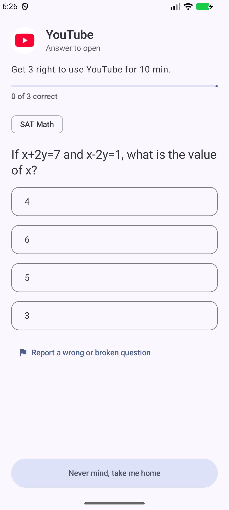
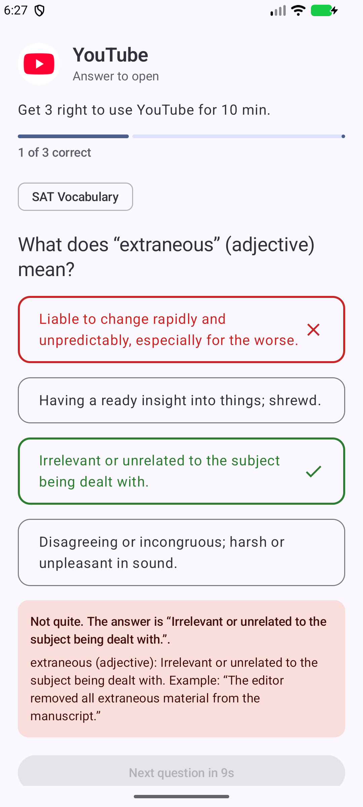
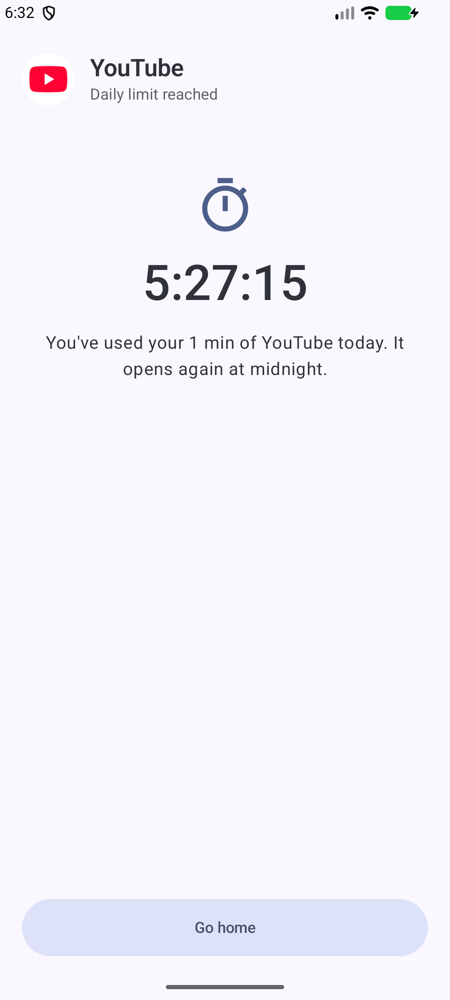
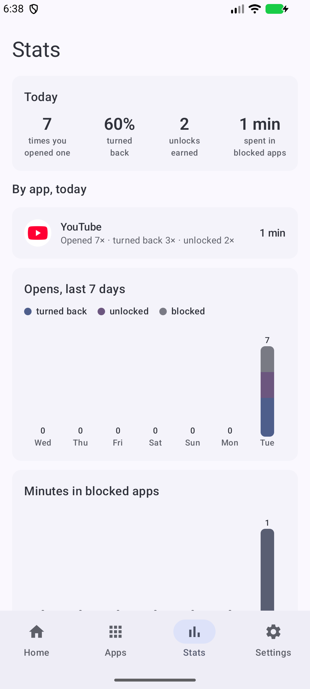

# LockApp

A personal app blocker for a Pixel 9 (Android 17). It covers Instagram, YouTube and anything else you pick in three ways:

- **Question gate.** You answer SAT or general-knowledge questions before the app opens. Each correct set earns a few minutes, then the gate comes back, even mid-scroll.
- **Daily limits.** For example, 30 minutes of Instagram a day. Once that's used up, the app is locked until midnight and no questions can unlock it.
- **Focus sessions.** Locks every blocked app for 25 min to 8 h. A session can be extended but never ended early.

A Stats tab shows how often you opened each app, how often you turned back, your unlocks and your minutes.

| Gate | Wrong answer | Daily limit | Stats |
|---|---|---|---|
|  |  |  |  |

## Install on the Pixel 9

Install over **adb or Android Studio**, not by tapping an APK file. File installs trigger Android's "Restricted settings", which blocks the accessibility and usage-access permissions this app needs.

1. On the phone, turn on Developer options: Settings → About phone → tap **Build number** 7 times.
2. Turn on USB debugging (Settings → System → Developer options), connect the phone with a cable and accept the prompt. Wireless debugging works too.
3. Build and install from this folder:
   ```bash
   JAVA_HOME="/Applications/Android Studio.app/Contents/jbr/Contents/Home" ./gradlew installDebug
   ```
4. Open **LockApp** and follow the setup screen:
   - Accessibility → **LockApp blocker** → on.
   - Allow usage access and notifications.
   - Tick the apps to block.
   - Turn off picture-in-picture for YouTube.
   - Tap **Start protecting**.

If the accessibility switch is greyed out, tap it once, then go to App info → ⋮ → **Allow restricted settings** and try again. This isn't possible during a phone call.

**Advanced Protection mode** (Settings → Security & privacy) must stay off. On Android 17 it disables accessibility access for apps like this one. About a day after setup, Android shows a one-time notice that "LockApp can view and control your screen". That's normal for this kind of app.

When you update the app later, run `installDebug` again. Don't uninstall first: uninstalling (or force-stopping) the app turns the blocker service off.

Android Studio 2025.2 probably can't sync this project, since it uses AGP 9.4. Update Studio first if you want to use the IDE. Command-line builds work without it.

## Strictness (Medium)

- Making a rule **stricter** applies immediately: blocking an app, lowering a limit, needing more answers.
- Making a rule **looser** waits until **midnight**. It shows as "Waiting until midnight" with a Cancel button.
- **During a focus session nothing can be loosened.**
- During first-run setup every change applies instantly.
- Turning the service off in Android Settings, or changing the clock, is still possible on purpose. Both show up in Stats.

## How it works

```
app comes to the foreground
  → BlockerService (AccessibilityService, window events only, no polling)
  → LockPolicy.decide()  focus > used-up limit > recent unlock > question gate
  → GateActivity covers the app (its own task; finishing it reveals the app again)
```

- **Daily usage** comes from `UsageStatsManager`.
- **While you use an allowed app**, a single timer re-checks the moment your unlock or allowance runs out.
- **Questions** come from a local database, so the gate never waits on the network and works offline.

### Questions

| Category | Source | Notes |
|---|---|---|
| General knowledge | [Open Trivia DB](https://opentdb.com) (CC BY-SA 4.0), about 1,360 bundled; more from [The Trivia API](https://the-trivia-api.com) (CC BY-NC 4.0) every 12 h | Online top-ups never block the gate |
| SAT Math | [OpenSAT](https://github.com/Anas099X/OpenSAT) bank (440 kept) + generated questions | See below |
| SAT Vocabulary | [core-word-list](https://github.com/siddharthagit/core-word-list) (MIT), 780 questions | |

**SAT Math quality.** The OpenSAT bank is largely machine-written and some of its answer keys are wrong. `tools/build_question_packs.py` keeps a question only if its worked explanation ends on the keyed answer. Where the answer can be re-computed (function values, one-variable equations), it re-computes it and drops any mismatch. That check caught 18 more bad keys. To limit what slips through:

- Half of all SAT maths questions come from `SatMathGenerator`, whose answers are correct by construction.
- The gate has a **Report a wrong or broken question** button that removes a question for good.

OpenSAT's reading and writing items were too unreliable to use at all.

Licences and attributions for the bundled question data are in [THIRD_PARTY_NOTICES.md](THIRD_PARTY_NOTICES.md). The bundled `gk.json` is CC BY-SA 4.0.

To rebuild the bundled packs:

```bash
python3 -I tools/build_question_packs.py --opensat <opensat.json> --words <words.json> --opentdb-cache <dir> --out app/src/main/assets/questions
```

## Development

```bash
./gradlew testDebugUnitTest   # policy, change guard, usage maths, picker, parsers, generators
./gradlew lintDebug assembleDebug
```

Debug builds include `DebugSeedReceiver`, which can be called only from `adb shell`. It sets up quick test scenarios, for example YouTube gated with 1 question and a 1-minute unlock:

```bash
adb shell am broadcast -n com.abdullah.lockapp/.debug.DebugSeedReceiver --es cmd seed \
  --es pkg com.google.android.youtube --ez gate true --ei required 1 --ei unlock 1 --ei cooldown 5
adb shell am broadcast -n com.abdullah.lockapp/.debug.DebugSeedReceiver --es cmd focus --ei minutes 2
```

The other commands are `endfocus`, `clearunlocks`, `applypending` and `testquestions --ez on true|false`.

## Not in v1

These are left for later:

- blocking only Reels/Shorts
- blocking instagram.com / youtube.com in Chrome
- a Quick Settings tile
- a "Hard" mode that guards the Settings screens
